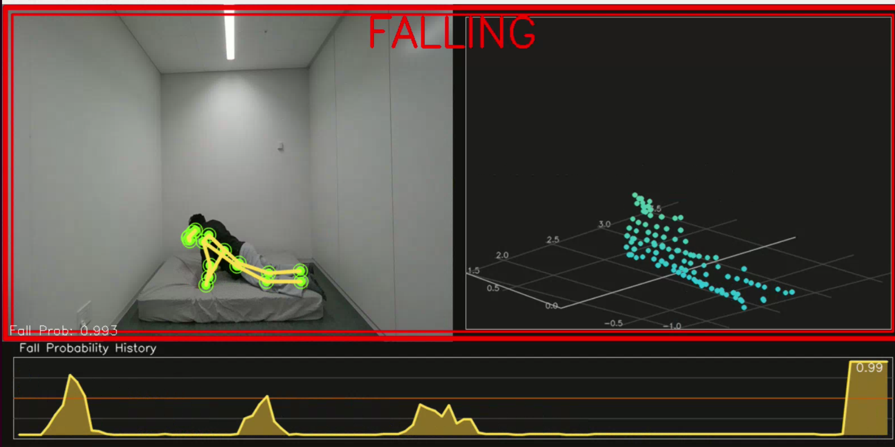
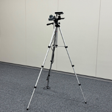
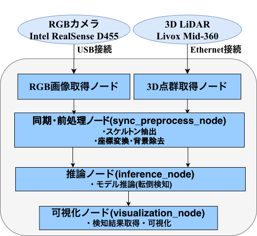

# RGBカメラ + LiDAR 転倒検知システム

RGBカメラとLiDARを用いたリアルタイム転倒検知システム



## はじめに

このシステムは、次の流れで使用する。

1. ZIPファイルを展開する
2. 機材を接続して設置する
3. Docker イメージをビルドする
4. 初回または環境変更時に起動前確認を実行する
5. 必要に応じて ROI を調整する
6. 転倒検知システムを起動する

## 前提環境

- Docker Engine / Docker Compose が使用可能であること
- NVIDIA GPU が利用可能であること
- NVIDIA Container Toolkit がセットアップ済みであること
- カメラ: Intel RealSense D455
- LiDAR: Livox MID-360



## 必要機材

- 転倒検知を実行する Linux PC
- NVIDIA GPU
- Intel RealSense D455
- Livox MID-360
- RealSense 接続用 USB ケーブル
- Livox 接続用 LAN ケーブル
- LiDAR 用電源アダプタ(Type-C)

## ディレクトリ構成

`data/` 配下は次のように使う。

```text
data/
├── checkpoints/
│   ├── camera/
│   │   └── best_model.pth
│   ├── lidar/
│   │   └── best_model.pth
│   └── fusion/
│       └── best_model.pth
└── model-cache/
    └── torch/hub/checkpoints/
        ├── rtmdet_m_8xb32-300e_coco_20220719_112220-229f527c.pth
        └── td-hm_ViTPose-small-simple_8xb64-210e_coco-256x192-4c101a76_20230314.pth
```

`data/checkpoints/` はLCFallの学習済み重み、`data/model-cache/` は姿勢推定器が参照するキャッシュであり、用途が異なる。

ホストPCから直接実行するスクリプトは次の4つである。

| スクリプト | 用途 |
|---|---|
| `scripts/run.sh` | 統合デモの通常起動 |
| `scripts/run_visualization.sh` | 可視化だけを別PCまたは同一PCで起動 |
| `scripts/run_roi_tuner.sh` | ROI調整GUIの起動 |
| `scripts/setup_and_check.sh` | 初期設定と単独の動作確認 |

`docker/` 配下はComposeがコンテナ内部で使用するため、ホストから直接実行しない。
ROS 2 Jazzyとの直接通信検証にだけ使用する資材は`validation/jazzy/`配下にまとめてあり、通常運用では使用しない。

## セットアップ

### 1. ZIPファイルを展開する

```bash
unzip lcfall-ros2.zip -d ~/
cd ~/lcfall-ros2
```

### 2. 推論モデルを確認する

3つのチェックポイントが `data/checkpoints/` に配置されているか確認する。

```text
data/
└── checkpoints/
    ├── camera/
    │   └── best_model.pth
    ├── lidar/
    │   └── best_model.pth
    └── fusion/
        └── best_model.pth
```

`app` 起動時に不足があれば、起動前にエラー表示して停止する。

### 3. Docker イメージをビルドする

```bash
docker compose build
```

コンテナ起動時に `lcfall_msgs` と `lcfall_ros2` は自動で `colcon build` されるため、
通常は手動ビルド不要。

### 4. センサを接続して設定する

#### センサの設置

LiDAR の ROI は、現在の設置状態を前提に動作する。
センサ位置が変わった場合は ROI 調整GUIで範囲を確認する。

#### ケーブル接続

- RealSense を USB でホスト PC に接続する
- Livox MID-360 を、ホスト PC の専用有線 NIC に LAN で接続する
- Livox の電源アダプタを接続する

#### 起動前の確認

- `./scripts/run.sh` の前に、RealSense と Livox の電源が入っていることを確認する
- RealSense はホスト側で `/dev/video*` が見えていることを確認する
- LiDAR 用 NIC は、ホスト Ubuntu 側で固定 IPv4 `192.168.1.50/24` に設定する
- 可視化を使う場合は、ホスト側の X11 が利用できる状態にする

RealSense の確認例:

```bash
ls /dev/video*
```

`app` 起動時は `scripts/run.sh` が存在する `/dev/video*` を列挙し、
一時的な Compose override としてコンテナへ渡す。この一時ファイルは `/tmp` に作成され、終了時に自動削除される。

可視化を有効にした場合、`scripts/run.sh` が現在のX11 displayとauthorityを検出し、authorityファイルをread-onlyでコンテナへ渡す。`xhost +`は不要である。

LiDAR 用 NIC の確認例:

```bash
ip addr
```

このシステムでは、LiDAR ネットワーク設定を次の固定値で運用する。

- ホスト PC 側 LiDAR 用 NIC: `192.168.1.50`
- Livox MID-360 側 IP: `192.168.1.198`

Livox ドライバ用の設定ファイルは
[config/livox/MID360_config.json](config/livox/MID360_config.json)
で管理しており、`docker compose` 起動時に自動で使用する。

#### ROS 2／Fast DDSネットワーク

正式構成はFast DDS、ROS Domain 43、`ROS_LOCALHOST_ONLY=0`を使用する。外部DDS通信は[config/fastdds/fastdds_wlo1.xml](config/fastdds/fastdds_wlo1.xml)によりWi-Fi NIC `wlo1`へ限定し、Livox専用NICとDocker bridgeをDDS通信に使用しない。Livox独自UDP通信は`enxf8e43b827753`を使用する。

Wi-FiのIPv4アドレスが変わった場合は、通常起動前に`./scripts/setup_and_check.sh`を実行してFast DDS XMLを現在の`wlo1`へ合わせる。別PCから購読する場合もROS Domain 43を使用する。

### 5. 起動前確認を単独実行する

初回導入時、ネットワーク変更時、または問題調査時に次を実行する。

```bash
./scripts/setup_and_check.sh
```

このスクリプトは、プロジェクト固有の安全に自動設定できる項目を設定した後、ホスト環境、GPU、Docker、Wi-Fi、Livox専用NIC、RealSense、Fast DDS、ROS 2トピック、実モデル推論を確認する。詳細ログは`/tmp/lcfall-setup-and-check.log`へ保存される。Dockerイメージが存在しない場合はビルドも実行する。Livox専用NICの修正が必要な場合に限り、`nmcli`実行のためsudo認証を求める。

通常起動とは独立しており、`scripts/run.sh`から自動実行されることはない。毎回の起動前に実行する必要もない。

### 6. ROIを調整する

カメラ映像とLiDAR点群を見ながら調整する場合は、次を実行する。

```bash
./scripts/run_roi_tuner.sh
```

保存したROIは `src/lcfall_ros2/config/params.yaml` に反映される。

### LiDARの傾きを調整する

LiDARの設置角度を変更した場合は、
`src/lcfall_ros2/config/params.yaml`の次の値を調整する。

```yaml
apply_coordinate_transform: true
lidar_roll: 1.1
lidar_pitch: 27.8
lidar_yaw: 0.0
```

- `lidar_roll`: 左右方向の傾き補正
- `lidar_pitch`: 前後方向の傾き補正
- `lidar_yaw`: 水平面上の向き補正

転倒検知アプリを停止した状態で、値を0.5〜1度ずつ変更してROI調整GUIを起動する。

```bash
./scripts/run_roi_tuner.sh
```

点群表示を確認し、次を目安に調整する。

- 床面が前後方向に傾いて見える場合は`lidar_pitch`を調整する
- 床面が左右方向に傾いて見える場合は`lidar_roll`を調整する
- 点群の水平方向が部屋の向きとずれる場合は`lidar_yaw`を調整する

角度を変更した場合はROI調整GUIを再起動する。現在のGUIは設定済みの角度を点群へ
反映するが、角度自体をGUI上で編集・保存する機能はない。調整完了後は通常どおり
アプリを起動する。

```bash
./scripts/run.sh
```

## 通常運用

### システム起動

センサドライバ、前処理、推論、可視化をまとめて起動する。

```bash
./scripts/run.sh
```

このコマンドは`setup_and_check.sh`を実行せず、既存イメージを`--no-build`で起動する。RealSenseのvideoデバイス割当と、可視化用X11設定だけを起動時に行う。

### 可視化なしで起動

```bash
ENABLE_VISUALIZATION=false ./scripts/run.sh
```

### 可視化だけを別PCで起動

可視化専用コンテナはGPU、カメラ／LiDARドライバ、推論モデルを含まず、次の
3トピックだけを購読する。

- `/camera/visualization/compressed`
- `/preprocessed/frame`
- `/fall_detection/result`

推論PCと可視化PCを同じLANへ接続し、マルチキャスト通信を許可する。両PCで
Fast DDS、`ROS_DOMAIN_ID=43`、`ROS_LOCALHOST_ONLY=0`を使用する。推論PCの
Fast DDS設定は`wlo1`へ限定されているため、可視化PCはそのWi-Fiネットワーク
から到達できる必要がある。無線APのクライアント間通信禁止機能は無効にする。

推論PCではローカル画面を無効にし、別PC向けJPEG配信だけを明示的に有効化して
通常アプリを起動する。

```bash
ENABLE_VISUALIZATION=false \
ENABLE_REMOTE_VISUALIZATION_STREAM=true \
./scripts/run.sh
```

別PC向け配信は640×360、JPEG品質70、10 FPSである。通常の`./scripts/run.sh`や
ローカル可視化だけを使う起動では既定値が`false`なので、縮小・JPEG圧縮・追加publishは
一切実行されない。

可視化PCへこのリポジトリを配置し、初回または可視化コード変更後に軽量イメージを
ビルドする。チェックポイントとNVIDIA GPUは不要である。

```bash
cd ~/lcfall-ros2
docker compose -f visualization/compose.yaml build
```

可視化だけを起動する。

```bash
./scripts/run_visualization.sh
```

停止する場合は`Ctrl+C`を押すか、別ターミナルで次を実行する。

```bash
docker compose -f visualization/compose.yaml down
```

ROS 2 Humbleと依存パッケージをホストへ直接導入している場合は、コンテナを使わず
次のlaunchでも可視化ノードだけを起動できる。

```bash
source /opt/ros/humble/setup.bash
source ~/lcfall-ros2/install/setup.bash
export RMW_IMPLEMENTATION=rmw_fastrtps_cpp
export ROS_DOMAIN_ID=43
export ROS_LOCALHOST_ONLY=0
ros2 launch lcfall_ros2 visualization.launch.py
```

別PC向け圧縮トピックを直接購読する場合は次の引数を付ける。

```bash
ros2 launch lcfall_ros2 visualization.launch.py use_compressed_image:=true
```

別名トピックを使う場合はlaunch引数で指定できる。

```bash
ros2 launch lcfall_ros2 visualization.launch.py \
  camera_topic:=/camera/image_raw \
  preprocessed_topic:=/preprocessed/frame \
  result_topic:=/fall_detection/result
```

圧縮設定は`params.yaml`の`remote_image_publisher_node`で変更できる。映像が遅延する
場合は`publish_fps`、`output_width`、`output_height`、`jpeg_quality`を下げるか、
推論PCと可視化PCのネットワーク品質を確認する。

### 停止

```bash
docker compose down
```

## ROS 2 Humble／Jazzy直接通信の再現手順

同一PC上のROS 2 Humble転倒検知アプリからROS 2 Jazzy subscriberへ、ブリッジなしで`/fall_detection/result`を直接配信できることを確認済みである。通常の`./scripts/run.sh`はJazzyコンテナを起動しない。検証時だけ`validation/jazzy/compose.yaml`を明示して起動する。

両側は次の通信設定を使用する。

- RMW: `rmw_fastrtps_cpp`
- ROS Domain: `43`
- `ROS_LOCALHOST_ONLY=0`
- Fast DDS profile: `config/fastdds/fastdds_wlo1.xml`
- QoS: Reliable、Keep Last、depth 10、Volatile
- Docker network／IPC: host

### 1. Jazzy検証イメージをビルドする

`lcfall_msgs`を変更した場合も、このコマンドでJazzy側のinterfaceを再ビルドする。

```bash
docker compose -f validation/jazzy/compose.yaml build jazzy-fall-subscriber
```

### 2. Jazzy subscriberを起動する

```bash
docker compose -f validation/jazzy/compose.yaml up -d --no-build jazzy-fall-subscriber
docker compose -f validation/jazzy/compose.yaml logs -f jazzy-fall-subscriber
```

subscriberは`/fall_detection/result`を待ち受け、受信ごとに通算件数、stamp、bool型の`prediction`、`confidence`を出力する。

### 3. Humble転倒検知アプリを起動する

別ターミナルで通常の転倒検知アプリを起動する。検証時に画面表示が不要なら可視化を無効にできる。

```bash
ENABLE_VISUALIZATION=false ./scripts/run.sh
```

センサ入力が48フレーム蓄積されると実推論が始まり、Jazzyログに次の形式で表示される。

```text
RECEIVED count=1 stamp=... prediction=False confidence=...
```

### 4. Jazzy subscriberだけを再起動する

Humbleアプリを動かしたまま、別ターミナルで実行する。

```bash
docker compose -f validation/jazzy/compose.yaml restart jazzy-fall-subscriber
docker compose -f validation/jazzy/compose.yaml logs -f jazzy-fall-subscriber
```

再起動後は`count=1`から受信が再開する。実機検証ではbool型への変更後に初回6件、subscriber再起動後3件を受信し、QoS不一致、Jazzy側のdeserialize error、subscriber例外がないことを確認した。ブリッジプロセスは使用していない。

Fast DDS 2.6.11を使用するHumble側では、Fast DDS 2.14.6のJazzy participantが同じDomainへ参加している間、discovery型情報の互換性に起因する`sequence size exceeds remaining buffer`が出力される。転倒検知msg本体は正常にdeserializeされるが、完全に警告なしの組み合わせではない。

### 5. 検証を停止する

```bash
docker compose -f validation/jazzy/compose.yaml stop jazzy-fall-subscriber
docker compose stop app
```

## トラブルシューティング

### checkpoint が足りないと言われる

`data/checkpoints/camera/best_model.pth`
`data/checkpoints/lidar/best_model.pth`
`data/checkpoints/fusion/best_model.pth`

上記 3 ファイルが存在するか確認する。

### 可視化ウィンドウが開かない

- ホスト側でX11セッションが利用可能か確認する
- `echo "$DISPLAY"`と`ls -l /tmp/.X11-unix/`でdisplayを確認する
- `XAUTHORITY`を明示している場合は、そのファイルが読み取り可能か確認する
- `DISPLAY`が未設定の場合、X11 socketが1つだけなら`scripts/run.sh`が自動選択する。複数ある場合は、利用するdisplayを明示する

```bash
DISPLAY=:1 ./scripts/run.sh
```

全ユーザーへX11アクセスを許可する`xhost +`は使用しない。

### RealSense が起動しない

- USB ケーブル接続を確認する
- ホスト側で `/dev/video*` が存在するか確認する
- ほかのアプリがカメラを占有していないか確認する

### Livox が起動しない

- 電源と LAN ケーブル接続を確認する
- ホスト側 LiDAR 用 NIC が `192.168.1.50` になっているか確認する
- [config/livox/MID360_config.json](config/livox/MID360_config.json) が利用されるため、コンテナ内の Livox 設定ファイルを手で編集していないか確認する
- `lcfall.launch.py` 起動時の host IP 警告メッセージを確認する

## パラメータ調整

主要な設定は [src/lcfall_ros2/config/params.yaml](src/lcfall_ros2/config/params.yaml) にある。

### 推論時の主な調整項目

| パラメータ | デフォルト | 説明 |
|---|---|---|
| `roi_x_min` 〜 `roi_z_max` | 各種 | LiDAR ROI 範囲 [m] |
| `inference_stride` | 10 | 推論間隔（同期後10 Hz想定で約1秒） |
| `fall_decision_threshold` | 0.5 | 転倒判定しきい値 |
| `camera_checkpoint_path` | `/data/checkpoints/camera/best_model.pth` | Camera 重み |
| `lidar_checkpoint_path` | `/data/checkpoints/lidar/best_model.pth` | LiDAR 重み |
| `fusion_checkpoint_path` | `/data/checkpoints/fusion/best_model.pth` | Fusion 重み |

## システム概要



## パッケージ構成

| パッケージ | 種類 | 概要 |
|---|---|---|
| `lcfall_msgs` | ament_cmake | カスタムメッセージ定義 |
| `lcfall_ros2` | ament_python | メインノード群、launch、config |

## ノード一覧

| ノード | 入力トピック | 出力トピック |
|---|---|---|
| `sync_preprocess_node` | `/camera/image_raw`, `/livox/lidar` | `/preprocessed/frame` |
| `inference_node` | `/preprocessed/frame` | `/fall_detection/result` |
| `alert_node` | `/fall_detection/result` | - |
| `visualization_node` | `/camera/image_raw`または`/camera/visualization/compressed`、`/preprocessed/frame`、`/fall_detection/result` | - |
| `remote_image_publisher_node` | `/camera/image_raw` | `/camera/visualization/compressed` |

## モデルアーキテクチャ

### Camera Branch — PoseC3D

| 項目 | 値 |
|---|---|
| backbone | `ResNet3dSlowOnly` (depth=50, in_channels=17) |
| cls_head | `I3DHead` (in_channels=512, num_classes=2) |
| 入力 | Heatmap `(B, 17, 48, 64, 64)` |
| Heatmap | PoseCompact → 64×64、sigma 0.6 |
| キーポイント | 17 点 |

### LiDAR Branch — PointNet++ + GRU

| 項目 | 値 |
|---|---|
| 空間特徴抽出 | PointNet++ 3 層 |
| 時系列学習 | GRU 2 層 |
| 入力 | `(B, 48, 256, 3)` |
| 出力特徴 | 512 次元 |

### Fusion — Late Fusion MLP

| 項目 | 値 |
|---|---|
| 入力 | Camera 512 次元 + LiDAR 512 次元 |
| 構造 | Linear(1024, 512) → BN → ReLU → Dropout → Linear(512, 2) |
| 出力 | 2 クラス |

## メッセージ定義

### PreprocessedFrame.msg

```text
std_msgs/Header header
float32[] skeleton_2d
float32[] pointcloud_frame
```

### FallDetectionResult.msg

```text
std_msgs/Header header
bool prediction
float32 confidence
```

## 座標変換

LiDAR センサ座標から部屋座標系への変換は、以下の回転行列で行っている。

```text
R = Rz(yaw) · Ry(pitch) · Rx(roll)
= Rz(0.0°) · Ry(27.8°) · Rx(1.1°)
```

`params.yaml` の `lidar_roll`, `lidar_pitch`, `lidar_yaw` で設定可能。

## 可視化 UI

`visualization_node` は 1 ウィンドウ内に左右 2 画面を表示する。

| 画面 | 内容 |
|---|---|
| 左 | 「カメラ映像」: カメラ画像 + skeleton overlay |
| 右 | 「LiDAR点群」: 点群の投影 |
| 上部 | 転倒時のみ「転倒を検知」を表示 |
| 下部 | 転倒確率グラフ（0.5超過区間は赤色） |

描画頻度は `params.yaml` の `display_fps` で変更できる（既定値: 15 FPS）。
この値は可視化だけに作用し、センサー取得・前処理・推論周期には影響しない。
